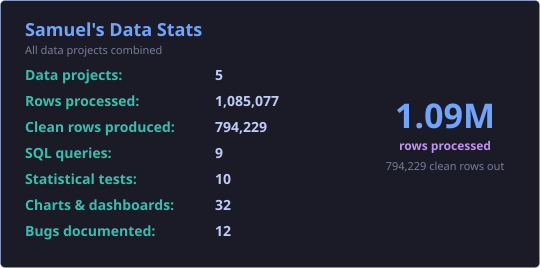

  

  Strive to be a contrarian, but only when the data says so.

  
  
  

<h2 align="center">Data Stats</h2>

<h2 align="center">Tech Stack</h2>

<i>From raw data to decision</i>

<table align="center">
  <tr>
    <td valign="top" align="center" width="50%">
      <b>1 · Collect &amp; Store</b>  
      
      
        
      <b>2 · Analyze</b>  
      
      
    </td>
    <td valign="top" align="center" width="50%">
      <b>3 · Visualize</b>  
      
        
      <b>4 · Workflow</b>  
      
      
    </td>
  </tr>
</table>
